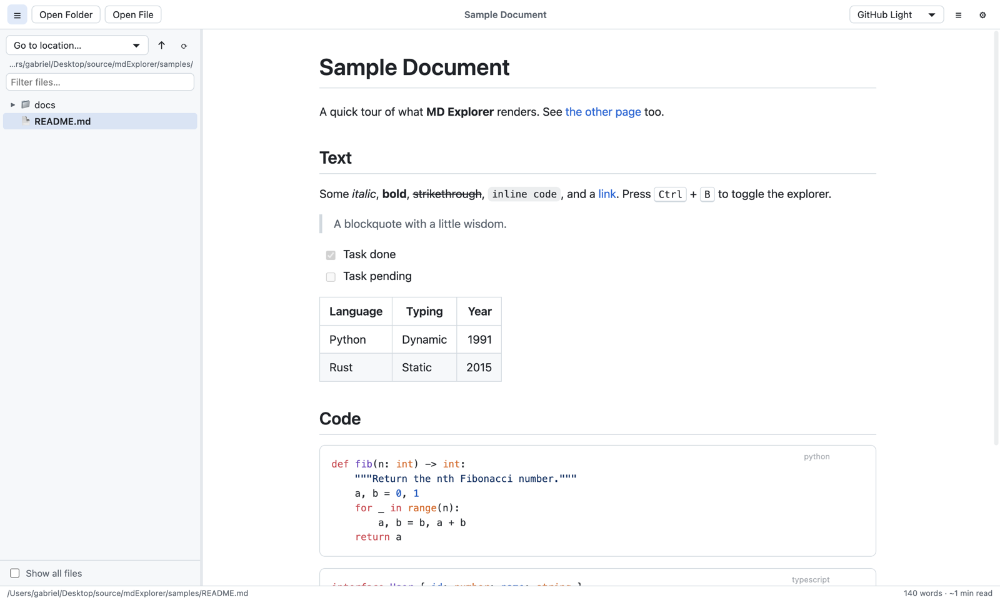
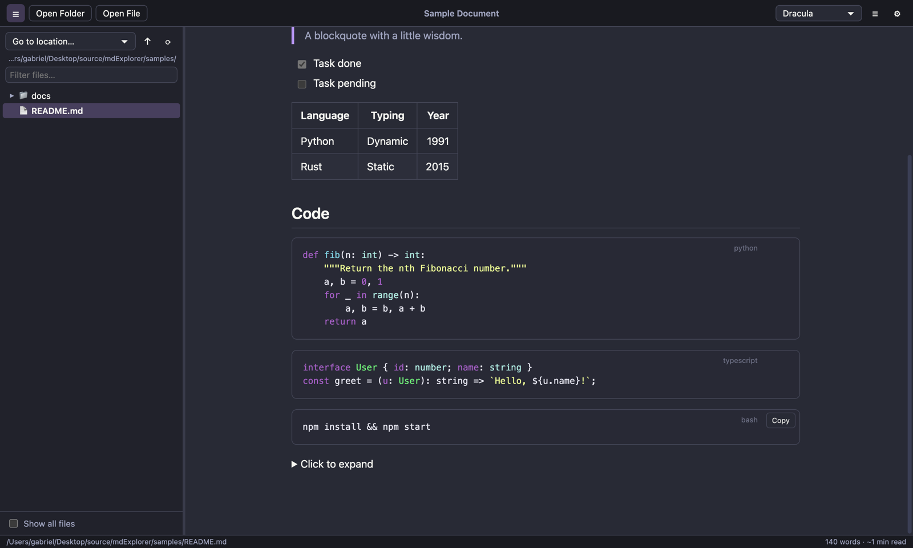
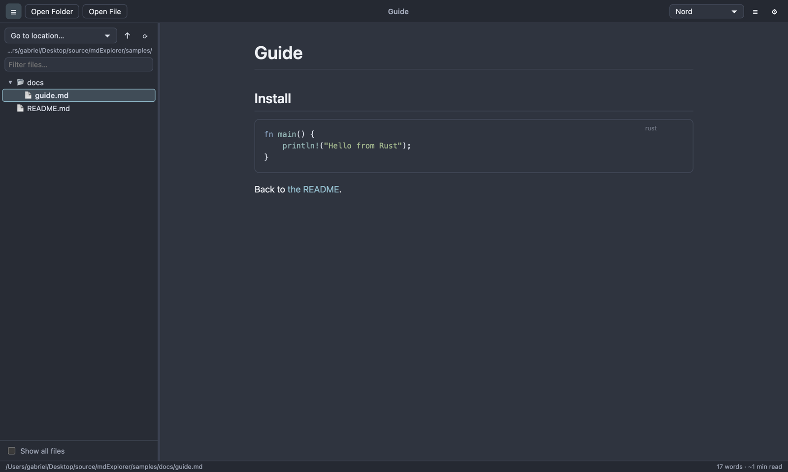
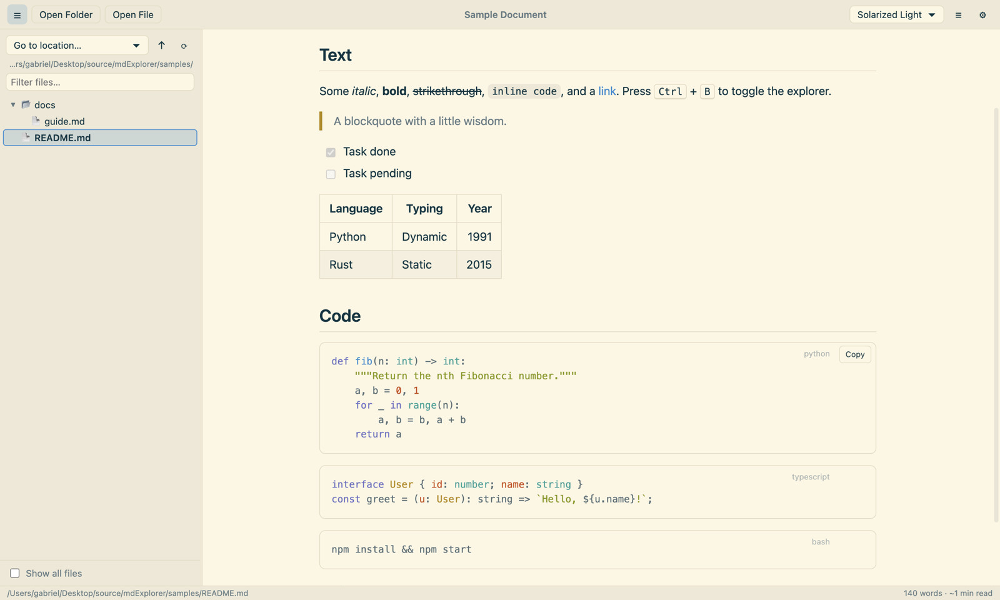
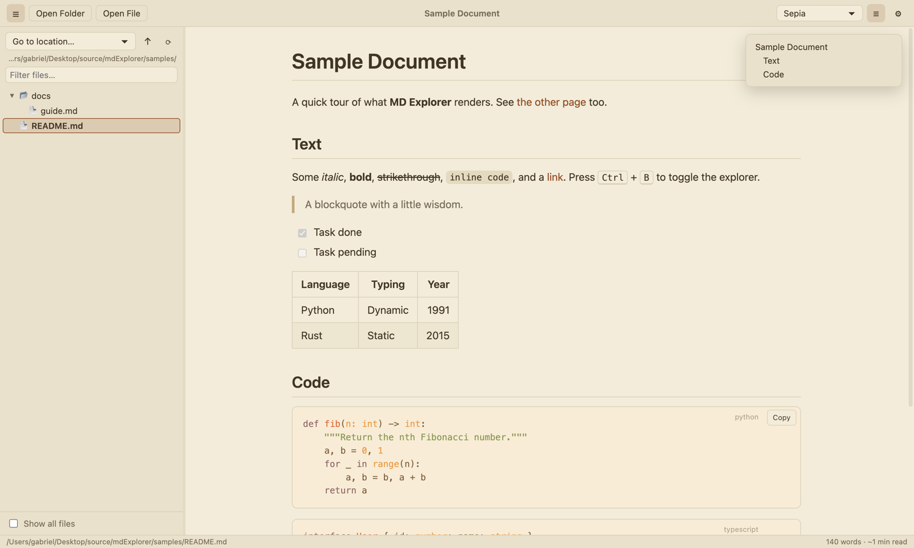
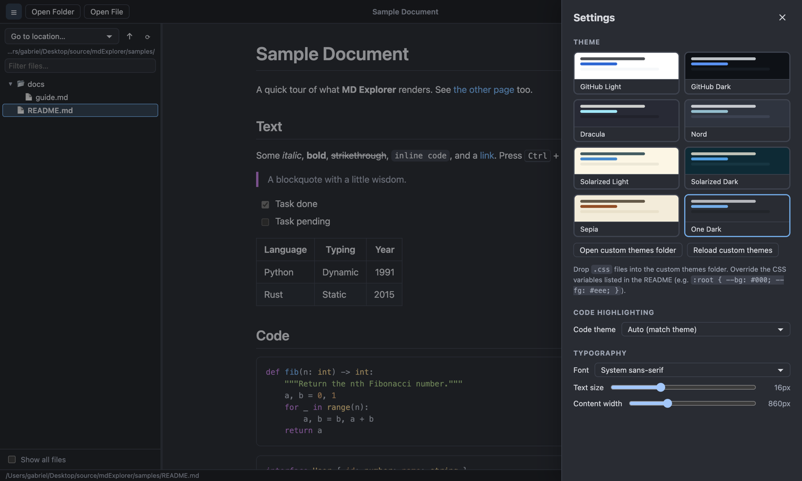

# MD Explorer

A cross-platform (macOS, Windows, Linux) Markdown viewer with a file explorer, themes and syntax highlighting. Built with Electron.



## Screenshots

| Dracula | Nord |
|---|---|
|  |  |
| **Solarized Light** | **Sepia, with table of contents** |
|  |  |
| **One Dark, settings panel** | |
|  | |

## Features

- **Explorer pane**: browse any folder or the whole file system (Home, Desktop, Documents, drives/volumes). Folders load lazily, you can filter by name, and the tree works with the arrow keys. Double-click a folder to make it the root. The pane can be resized or hidden (`Ctrl/Cmd+B`).
- **Markdown rendering** with [markdown-it](https://github.com/markdown-it/markdown-it): tables, task lists, heading anchors, auto-links, and inline HTML (sanitized, so scripts are stripped).
- **Syntax highlighting** with [highlight.js](https://highlightjs.org/) (190+ languages, 100+ code themes), plus a copy button on code blocks.
- **Mermaid diagrams** from ```` ```mermaid ```` code blocks, themed to match, with zoom (Ctrl/Cmd+scroll, pinch or buttons) and drag-to-pan; double-click resets the view.
- **Themes**: 8 built-in themes (GitHub Light/Dark, Dracula, Nord, Solarized Light/Dark, Sepia, One Dark). You can add your own as CSS files. Font, text size and content width are adjustable.
- **Live reload**: the open file re-renders when it changes on disk.
- Relative links to other `.md` files open in the app, relative images load, and external links open in your browser.
- Table of contents, find in page (`Ctrl/Cmd+F`), drag and drop of files or folders, and file associations for `.md`.

## Development

```bash
npm install
npm start                 # launch the app
npm start -- samples      # open a folder or file directly
```

## Building executables

[electron-builder](https://www.electron.build/) packages the app. The output goes to `dist/`.

```bash
npm run dist:mac      # .dmg + .zip           (run on macOS)
npm run dist:win      # NSIS installer + portable .exe  (run on Windows)
npm run dist:linux    # AppImage + .deb       (run on Linux)
npm run dist          # whatever suits the current OS
```

- **Build each platform on that OS.** Cross-building mostly works for Linux targets but is unreliable for macOS and Windows. A GitHub Actions matrix (`macos-latest`, `windows-latest`, `ubuntu-latest`) is the easy way to get all three.
- **Architecture:** builds default to the host architecture. Add `--x64`, `--arm64` or `--universal` (macOS) to choose, e.g. `npx electron-builder --mac --universal`.
- **Code signing:** builds are unsigned by default. On macOS, Gatekeeper blocks unsigned apps until the user right-clicks → Open. Distributing properly needs an Apple Developer ID plus notarization. On Windows, SmartScreen warns about unsigned installers until you sign with a code-signing certificate. See [electron.build/code-signing](https://www.electron.build/code-signing).
- **Icon:** add `build/icon.icns` (macOS), `build/icon.ico` (Windows) and `build/icon.png` (Linux, 512×512) to replace the default Electron icon.

## Custom themes

Open **Settings → Open custom themes folder**, drop in a `.css` file and click **Reload custom themes**. A theme overrides these variables:

```css
:root {
  color-scheme: dark; /* "dark" makes the auto code theme use a dark style */
  --bg: #1b1b1f;
  --fg: #e4e4e7;
  --muted: #a1a1aa;
  --border: #3f3f46;
  --link: #60a5fa;
  --accent: #60a5fa;
  --code-bg: #111114;
  --inline-code-bg: #27272a;
  --sidebar-bg: #141417;
  --sidebar-fg: #e4e4e7;
  --hover: rgba(255, 255, 255, 0.06);
  --selected: rgba(96, 165, 250, 0.2);
  --quote-bar: #52525b;
  --table-stripe: #1f1f23;
  --toolbar-bg: #141417;
  --mark: #facc1555;
}
```

You can also target any element, e.g. `.markdown-body h1 { font-family: Georgia; }`.

## Project layout

```
src/main.js          Electron main process: window, menu, filesystem IPC, file watching
src/markdown.js      markdown-it + highlight.js rendering, link rewriting, sanitizing
src/settings.js      settings persisted to <userData>/settings.json
src/preload.js       safe IPC bridge (contextIsolation + sandbox)
src/renderer/        UI: explorer tree, viewer, themes, settings panel
samples/             example markdown for trying the app
```
